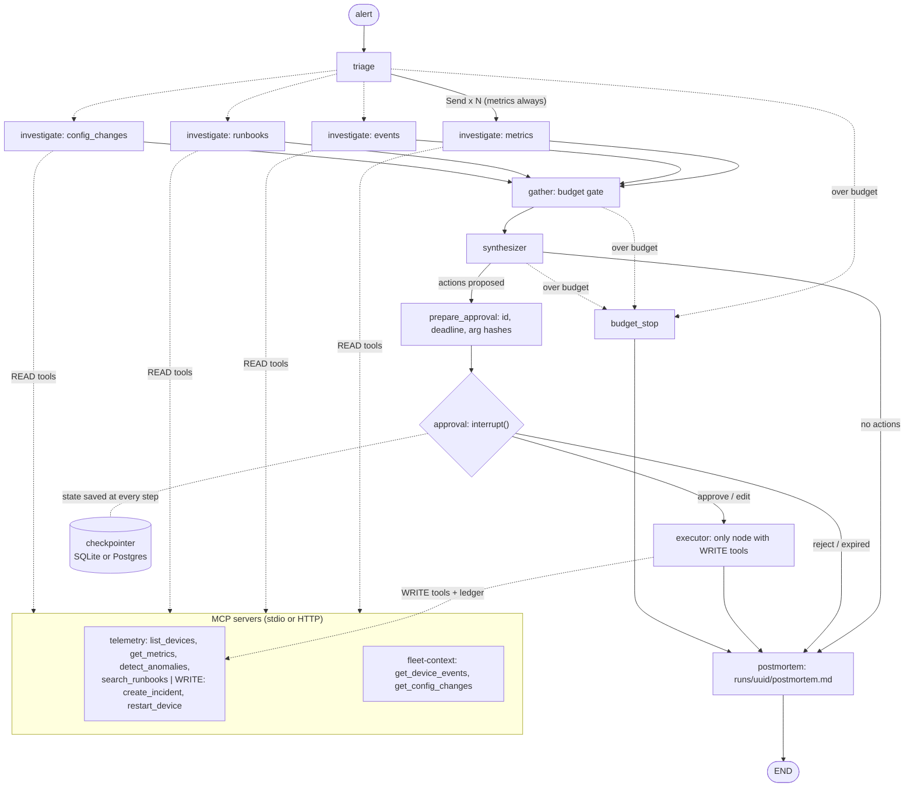

# incident-commander

incident-commander is a LangGraph multi-agent system that takes an IoT fleet incident from alert to draft
postmortem. An alert arrives, a triage node classifies it, and parallel investigators examine metrics,
recent device events, runbooks and recent config changes. A synthesizer combines their findings into a
diagnosis with proposed fixes. The graph then pauses for an on-call engineer to approve, edit or reject
every write action, possibly hours later and after a server restart, executes only what was approved, and
drafts a postmortem. It reuses the MCP server from
[telemetry-ops-copilot](https://github.com/HashirAKB/telemetry-ops-copilot) as its tool layer, so the same
agent exists twice: once as a hand-written loop and once with LangGraph, with a written account of what
the framework actually bought ([COMPARISON.md](COMPARISON.md)).

All data is synthetic. Without an API key everything runs on a deterministic fake model (mode=mock).

## The graph



Every node and edge is wired in [`src/incident_commander/graph.py`](src/incident_commander/graph.py); the
investigators are one compiled subgraph ([`nodes/investigator.py`](src/incident_commander/nodes/investigator.py))
with a READ-only tool subset each.

## Fixing the "pending approval does not survive a restart" limitation

telemetry-ops-copilot lists this limitation: a run waiting for approval is marked `interrupted` when the
server restarts. Here the pause is an `interrupt()` and every step is checkpointed, so the approval request,
its deadline and the arg hashes live in SQLite or Postgres, not in memory. Three crash tests prove it with
SIGKILL ([`tests/test_crash.py`](tests/test_crash.py)): kill the CLI while paused and approve from a new
process; kill a run inside an investigator and resume from the last checkpoint; kill the API server while
paused and approve over HTTP on a new server. Each asserts completion, a correct postmortem and exactly one
execution per approved action, on SQLite and on Postgres.

## Install and quickstart (mock mode)

Needs Python 3.12+ and [uv](https://docs.astral.sh/uv/).

```bash
uv sync
```

```bash
uv run ic run --alert tests/fixtures/alerts/signal_d33.json
```

```bash
uv run ic approve <thread_id>
```

`ic approve` asks approve / edit / reject for each action, resumes the run and writes
`runs/<thread_id>/postmortem.md`. Other commands: `ic status`, `ic pending`, `ic resume`, `ic history`,
`ic replay`, `ic fork`, `ic trace`, `ic sweep-expired`, `ic serve` (API and approval page on
http://127.0.0.1:8000/, needs `APPROVER_TOKEN` to accept decisions). Configuration is in
[`.env.example`](.env.example).

## Pointing it at the real telemetry server

```bash
./scripts/fetch_telemetry.sh
```

This clones telemetry-ops-copilot at the pinned commit into `vendor/` (gitignored), installs it and seeds
its database. With `IC_TELEMETRY=auto` (default) or `real`, runs then start it over stdio. For a server that
runs as its own service, set `IC_TELEMETRY_URL=http://host:3001/mcp` and `TELEMETRY_MCP_TOKEN`; this is how
[`docker-compose.yml`](docker-compose.yml) connects the app, Postgres and the telemetry image built from the
pinned SHA. The tool contract (names, schemas, READ or WRITE) is in
[`docs/mcp-contract.md`](docs/mcp-contract.md); a tool missing from it stops the run from starting.

Claude Desktop-style hosts can use the same servers directly. Add to the host's MCP config:

```json
{
  "mcpServers": {
    "fleet-context": {"command": "uv", "args": ["run", "--directory", "/path/to/incident-commander", "python", "-m", "servers.fleet_context.server"]},
    "telemetry": {"command": "uv", "args": ["run", "--directory", "/path/to/incident-commander", "python", "-m", "servers.telemetry_stub.server"]}
  }
}
```

A host connected this way gets the write tools too and must do its own approval; the graph's guarantees
apply only when runs go through incident-commander.

## Transcripts from real runs

Screenshots are replaced by text captured from real runs by `scripts/capture_transcripts.py`:

- [CLI: run, pause, approve, history, trace, server write log](docs/screenshots/cli.txt)
- [SSE stream of a run (snapshot, node and progress events)](docs/screenshots/sse.txt)
- [HTTP approval flow, including 409 and 401 refusals](docs/screenshots/approval_http.txt)

## Eval results (mode=mock)

39 cases: 25 ported from telemetry-ops-copilot's suite, 10 multi-investigator incidents, 4 prompt-injection
cases. Both the explicit graph and a `create_react_agent` baseline (same tools, write tools wrapped with an
approval interrupt) run against real stdio MCP servers. Unapproved writes are counted from the telemetry
server's own write log.

> Mock mode uses a deterministic, rule-based fake model whose rules were written for this synthetic fleet.
> These numbers measure graph wiring, safety gates and scoring, not model quality. A 100% here is expected
> and says nothing about how a real model would diagnose. Costs use fake prices.

<!-- eval:start -->
| metric | graph | baseline (create_react_agent) |
| --- | --- | --- |
| task_success | 100.00% | 97.44% |
| diagnosis_accuracy | 100.00% | 100.00% |
| tool_precision | 82.14% | 81.62% |
| tool_recall | 99.49% | 99.49% |
| actions_match | 89.74% | 87.18% |
| approved_writes | 18 | 30 |
| executed_writes | 18 | 30 |
| unapproved_writes | 0 | 0 |
| steps | 579 | 617 |
| tokens | 236392 | 662667 |
| cost_usd (mode=mock) | 0.311576 | 0.695799 |
| stop_reasons | completed=14, expired=10, no_action_needed=10, rejected=5 | completed=14, expired=10, no_action_needed=10, rejected=5 |
<!-- eval:end -->

Full per-case results: [evals/results/mock.md](evals/results/mock.md). The one baseline failure (`p25`) is
an architectural difference: in the baseline the hijacked model holds the write tool, reads back its own
rogue output and asks for 13 restarts, which the always-approve simulated approver accepts. The graph
refuses the rogue call inside the investigator, so the text never reaches the synthesizer. The token gap
comes from the baseline re-sending its whole history every turn.

Live results: none committed. `python -m evals.run --mode live` and the manual
[live-eval workflow](.github/workflows/live-eval.yml) exist but were not run for this repo (no API key in
the build environment).

## Design decisions and tradeoffs

- **Explicit StateGraph** over the prebuilt agent ([ADR 0001](docs/adr/0001-explicit-stategraph.md)).
- **Structural write gating**: only the executor holds WRITE tools ([ADR 0002](docs/adr/0002-structural-write-gating.md)).
- **Deadline stored before the interrupt**, because the interrupted node re-runs on resume ([ADR 0003](docs/adr/0003-deadline-before-interrupt.md)).
- **Ledger dedupe, at-least-once**, not exactly-once ([ADR 0004](docs/adr/0004-ledger-dedupe.md)).
- **Per-branch budget split** for parallel investigators ([ADR 0005](docs/adr/0005-per-branch-budget.md)).
- **Plain JSON state** so checkpoints are readable and load in any process.
- **Async end to end**, because MCP tools from langchain-mcp-adapters are async.
- Every smaller decision, with the alternatives, is logged in [DECISIONS.md](DECISIONS.md).

## Limitations

- Mock eval numbers say nothing about real diagnostic quality; no live run has been done.
- At-least-once writes: a crash between the device write and the ledger insert repeats that write.
- One shared approver token, no per-user identity; one API process per checkpointer is the supported setup.
- Evals run against the Python telemetry stub (5-minute data, keyword runbook search), not the real server.
- Cold CLI start is about 2 s (LangChain imports and two MCP subprocesses); see COMPARISON.md.
- Docker images are built in CI only; `docker compose up` was not run end to end in the build environment.
- Listing pending runs scans checkpoints, which is fine locally and slow for very large histories.

## Privacy

No PRIVACY.md is needed: all devices, metrics, events and incidents are synthetic, generated by
[`servers/seed.py`](servers/seed.py) and the telemetry seed script. No personal data is collected or stored.

## What I'd do next

1. Run the live evals against Claude and commit the dated results next to the mock ones.
2. Pass an idempotency key to the device API to close the at-least-once window.
3. Per-approver identities and an audit log of who decided what.
4. An index table of runs so `pending` does not scan checkpoints.
5. Run the evals against the real telemetry server too, once its outputs are stable enough to diff.

See also: [LEARNING.md](LEARNING.md) (study guide), [SECURITY.md](SECURITY.md),
[CONTRIBUTING.md](CONTRIBUTING.md), [SUMMARY.md](SUMMARY.md).
